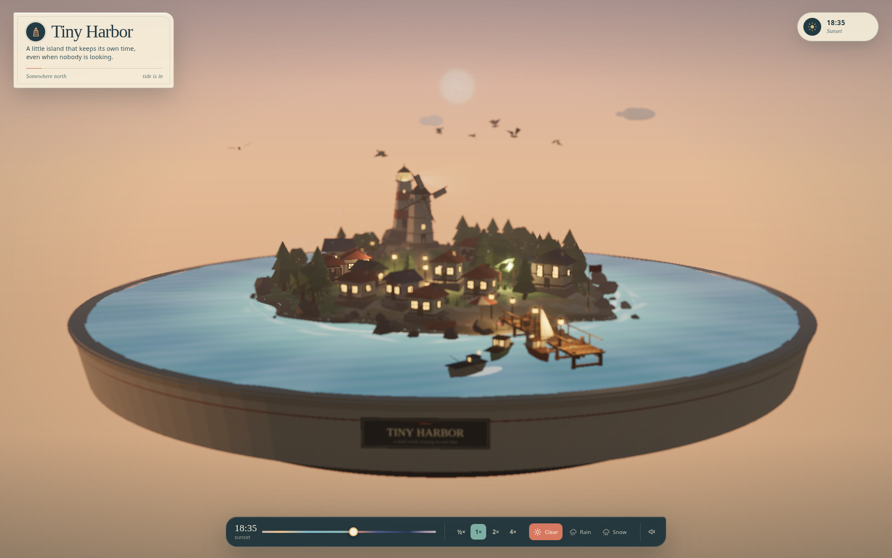
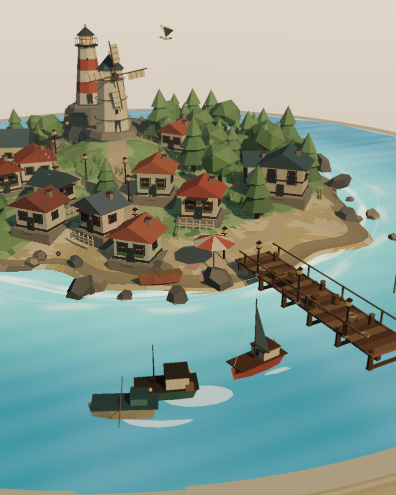
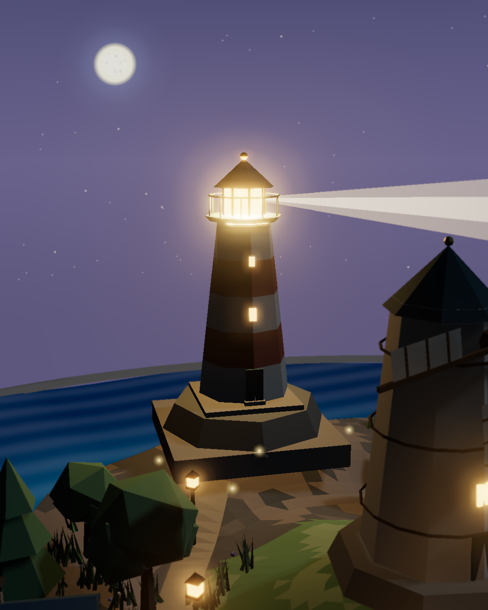
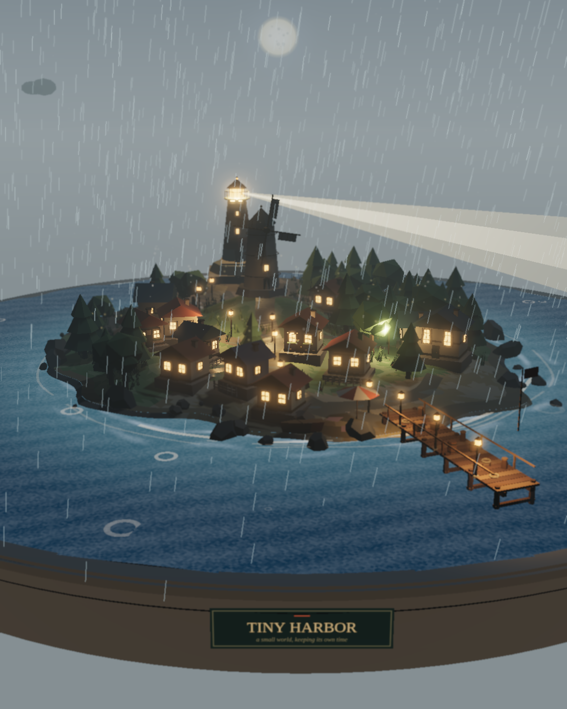

<div align="center">
<h1>Tiny Harbor</h1>
<p><em>A small island that keeps its own time, even when nobody is looking.</em></p>
<p><sub>three.js 0.170.0 &nbsp;·&nbsp; no build step &nbsp;·&nbsp; 60-second days &nbsp;·&nbsp; desktop + mobile</sub><br>
<sub>generated by <strong>deepseek-v4.1-flash</strong></sub></p>
<p></p>
<p><sub>18:35 · the windows come on before the sun is quite gone</sub></p>
<p><a href="#run">run</a> &nbsp;·&nbsp; <a href="#the-day">the day</a> &nbsp;·&nbsp; <a href="#the-film">the film</a> &nbsp;·&nbsp; <a href="#controls">controls</a> &nbsp;·&nbsp; <a href="#publish">publish</a></p>
</div>

At 06:25 the fog is still deciding what the island looks like. By noon the windmill turns in a wide blue sky; at 18:35 the cottage windows come on one at a time; at 23:16 Old Wick sweeps the water and the fireflies are up. Tiny Harbor is a one-minute day you can hold in your hand, built entirely from geometry, shaders and seeded chance.

No models, no textures, no image files in the scene. Just three.js 0.170.0, a stack of pastel shapes and a sea that never quite sits still.

## Run

```bash
python3 -m http.server 8080
```

Open <http://127.0.0.1:8080/>. The local server is required for ES modules. Use a recent Chrome, Edge, Firefox or Safari with WebGL 2.

## The day

- **A harbor with a timetable.** Three boats sail slow loops, nose into the pier, wait a while and leave again.
- **A village that wakes.** A dozen cottages, a windmill on the hill and Old Wick lighthouse on the cliff. Windows and street lamps arrive one by one at dusk.
- **Weather with weight.** Rain darkens the sky, rings the sea and varnishes the lanes. Snow falls slowly and whitens the roofs, slope by slope.
- **Small things, always moving.** Grass and trees sway in instanced flocks, chimney smoke climbs, gulls circle, fish jump, fireflies drift.
- **A camera that wanders.** Drag, scroll, pinch. Leave it alone for ten seconds and it begins drifting around the harbor on its own.
- **A voice, off by default.** Procedural surf, wind and a faraway harbor bell, synthesized in the browser.

## The film

Open <http://127.0.0.1:8080/?record=1>. The page becomes a fixed 1080 × 1350 film: the UI disappears, the camera goes on rails and the island plays out forty seconds:

```
00:00  dawn, through mist
00:07  the boats leave the harbor
00:12  noon, a close pass at the windmill
00:21  sunset, windows coming on
00:26  night, the beam and the fireflies
00:36  rain over the harbor
00:40  pull back to the whole island
```

<table>
  <tr>
    <td align="center" width="33%"></td>
    <td align="center" width="33%"></td>
    <td align="center" width="33%"></td>
  </tr>
  <tr>
    <td align="center"><sub>07.2 s · the boats leave</sub></td>
    <td align="center"><sub>26.2 s · the light turns</sub></td>
    <td align="center"><sub>36.4 s · rain arrives</sub></td>
  </tr>
</table>

The timeline is keyed to the frame number and simulated at a fixed 1/60 s, so two plays reproduce the same scene state. It stops on the last frame. Capture it with a screen recorder, or hold frame zero with `?record=1&paused=1` and step it with the development hook below.

## Controls

| Move | Do this |
| --- | --- |
| Orbit | Drag |
| Zoom | Scroll or pinch |
| Visit | Click a boat, cottage, the windmill or the lighthouse |
| Go home | Click the empty sea, or *Return to the whole island* on the note card |
| Change the hour | Drag the time slider |
| Change the pace | `½×`, `1×`, `2×`, `4×` |
| Change the weather | *Clear*, *Rain* or *Snow* |
| Listen | The sound button, off by default |

Mira's cottage, the miller's windmill, Old Wick lighthouse and the boat Nell each have a small note. Time scrubbing pauses the clock until you choose a speed again.

## Under the hood

| | |
| --- | --- |
| **Form** | One island, one sea, one sky, all generated at load. No models, textures or image files. |
| **Light** | A 60-second sun cycle and a staged moon; 2048 sun and 1024 moon shadow maps; hemisphere fill. |
| **Water** | Custom GLSL waves, fresnel sky reflection, shoreline foam and rain ripples. |
| **Frame** | Bokeh tilt-shift, gentle bloom, ACESFilmic tone mapping, sRGB output, DPR capped at 2. |
| **Build** | None. Static files, ES modules and a pinned three.js 0.170.0 import map. |

Nature is instanced, static props are merged, small shadow casters are culled, and the film shares the scene's deterministic clock. Day/night state is a pure function of time; weather ramps and boat cues are fixed-step.

## Publish

The site is plain static files with relative paths, and `.nojekyll` is included. It was tested under a `/tiny-harbor/` subpath, so a GitHub project page works unchanged.

<details>
<summary><strong>GitHub Pages, branch deploy</strong></summary>

1. Create an empty public repository named `tiny-harbor`.
2. From this folder:

   ```bash
   git init
   git add .
   git commit -m "Add Tiny Harbor"
   git branch -M main
   git remote add origin https://github.com/<username>/tiny-harbor.git
   git push -u origin main
   ```

3. On GitHub: **Settings → Pages → Build and deployment**. Set **Source** to **Deploy from a branch**, choose **main** and **/ (root)**, and save.
4. Open `https://<username>.github.io/tiny-harbor/` once the first deployment finishes.

No build step and nothing to install. The site's only external request is the pinned three.js import map from jsDelivr. Push to `main` to redeploy.

Prefer Actions? Set **Source** to **GitHub Actions** and add a Pages workflow; the branch route above needs no workflow file.

</details>

## Verification

Verified 1 November 2026.

- Headless Chromium, desktop and a 390 × 844 phone, at both the home path and a `/tiny-harbor/` subpath: no console errors and no failed requests.
- Mira's cottage, the miller's windmill, Old Wick lighthouse and Nell all focus and return; hover cursor, time scrub, speed, weather, sound and idle auto-orbit checked.
- Record mode fixes the canvas at 1080 × 1350, hides the UI and renders every beat in the shot list.
- **Performance, honestly:** about **1.2 fps** (median of four samples, 0.77–3.39) at 1600 × 1000 under SwiftShader, a software rasterizer. That is not a GPU measurement. The same frame drew 3,209 calls and 150,629 triangles with 353 shadow casters. The scene is built for 60 fps on hardware WebGL, but that was not benchmarked on a GPU here.
- Two plays share the same frame-keyed state. Separate browser or GPU contexts can still differ by a hair in rasterization.

<details>
<summary><strong>Development hooks</strong></summary>

```js
window.__tinyHarbor.setDayTime(0.72);   // 0..1 through the day
window.__tinyHarbor.pauseTime(true);
window.__tinyHarbor.setWeather('rain');
window.__tinyHarbor.renderOnce();
```

In record mode, `filmStill(seconds)` steps the film forward a frame at a time and renders that exact moment, so weather ramps and particle positions match the live film. Request stills in ascending order:

```js
window.__tinyHarbor.filmStill(26.2);
```

</details>

## Frames

The required states are in `screenshots/`: [dawn](./screenshots/dawn.png), [noon](./screenshots/noon.png), [sunset](./screenshots/sunset.png), [night](./screenshots/night.png), [rain](./screenshots/rain.png) and [snow](./screenshots/snow.png), plus [mobile](./screenshots/mobile.png) and film stills from 0 to 40 seconds.

---

<div align="center">
<p></p>
<p><sub>Designed, written and verified by <strong>deepseek-v4.1-flash</strong> in one session.<br>
Original procedural work. No existing game, film or artwork was copied.<br><br>
Somewhere north · the tide is in</sub></p>
</div>
